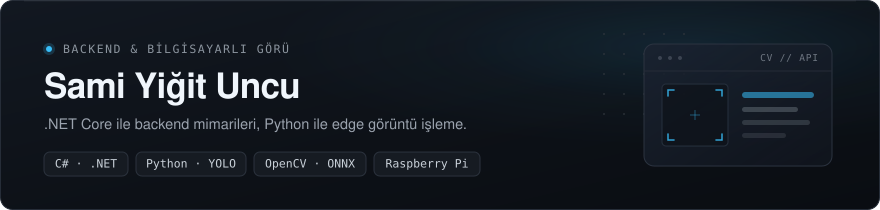

  <picture>
    <source media="(prefers-color-scheme: dark)" srcset="./assets/hero-dark.svg" />
    <source media="(prefers-color-scheme: light)" srcset="./assets/hero-light.svg" />
    
  </picture>

  
    <a href="https://www.linkedin.com/in/samiyigituncu/">LinkedIn ↗</a>
    &nbsp;&nbsp;·&nbsp;&nbsp;
    <a href="mailto:yyigituncu@gmail.com">yyigituncu@gmail.com ↗</a>
  

> Bilgisayar Mühendisliği öğrencisiyim. Ağırlıklı olarak **C# / .NET** tarafında backend ve API geliştirme üzerine çalışıyor; **Python, OpenCV, YOLO ve ONNX Runtime** ile Raspberry Pi gibi donanımlar üzerinde görüntü işleme projeleri yapıyorum.

## Seçili Projeler

| Proje | Kapsam & Teknoloji |
| :--- | :--- |
| [**EmlakAsistanAI**](https://github.com/yyigituncu/EmlakAsistanAI) | Clean Architecture, birim/entegrasyon testleri ve Docker Compose desteğiyle geliştirilmiş; sesli notları müşteri ve ilan kayıtlarına dönüştüren yapay zekâ destekli CRM uygulaması. `ASP.NET Core` · `EF Core` · `React Native` · `SQL Server` |
| [**DolapAnaliz**](https://github.com/yyigituncu/DolapAnaliz) | Dolap ve raf fotoğraflarından ürünleri tespit edip sınıf bazında sayım yapan YOLO26 tabanlı bilgisayarlı görü sistemi. `Python` · `YOLO26` · `OpenCV` |
| **PTS — Plaka Tanıma** Staj · Kapalı kaynak | Kamera görüntüsünden araç plakalarını algılayıp OCR ile metne döken görüntü işleme sistemi; ana işlem sunucuda çalışır, Raspberry Pi ise yedek (failover) olarak devreye girer. `Python` · `OpenCV` · `ONNX Runtime` · `Raspberry Pi` |
| [**Konya ACO**](https://github.com/yyigituncu/konya-aco-optimization) | Karınca Kolonisi Algoritması (ACO) kullanarak Konya haritası üzerinde en kısa rota ve mesafe optimizasyonu. `Python` · `ACO` |

## Teknik Odak

| Alan | Araçlar & Teknolojiler |
| :--- | :--- |
| **Backend & API** | `C#` · `.NET Core` · `ASP.NET Core Web API` · `Entity Framework Core` |
| **Görüntü İşleme & Edge AI** | `Python` · `OpenCV` · `YOLO` · `ONNX Runtime` · `Raspberry Pi` |
| **Veri & Altyapı** | `MS SQL Server` · `PostgreSQL` · `Docker` · `Linux` · `Git` |
| **Mobil & Arayüz** | `React Native` · `TypeScript` |

 

  Fikir alışverişi veya iş birliği için <a href="mailto:yyigituncu@gmail.com">e-posta</a> ya da <a href="https://www.linkedin.com/in/samiyigituncu/">LinkedIn</a> üzerinden ulaşabilirsiniz.

